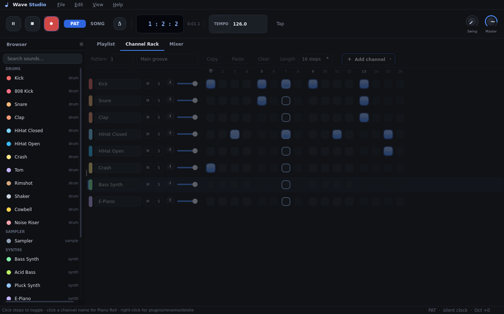

# Wave Studio

A modern, minimal **desktop DAW** written in pure Python (Qt + NumPy) —
FL-Studio-inspired workflow with a custom real-time synthesizer, sequencer
and **plugin engine**. Dark grey + blue design, smooth animations, custom
drawn icon. Designed in HTML/CSS first (`design/mockup.html`), then ported
pixel-for-pixel to Qt. Launches maximized; `F11` = true fullscreen.



## What's inside

### Compose
- **Channel Rack** — animated step sequencer; click steps to build patterns.
  Chase light flashes when the playhead hits an active step. Mute/solo, pan,
  volume per lane; channel selection for keyboard input; rows highlight with
  an accent bar when selected.
- **Piano Roll** — add/move/resize notes (resize by the right edge), snapping,
  velocity (Alt+wheel on a note), follow-playhead scrolling, smooth playhead.
  Click the **key strip** to audition any pitch, or hit the in-window
  **▶ Play** button (Space works too, from anywhere).
- **Playlist** — paint pattern clips onto 5 tracks × 64 bars, drag to move,
  snap bar/beat/step; SONG mode loops the arrangement.
  v2.1: **mute any track** from its header LED, **resize clips** by dragging
  their right edge, **zoom** (60–220 %), **click the ruler to seek** the
  playhead, and **right-click a clip** to duplicate / delete / open its
  pattern. The playhead rides with a diamond tip.
- **16 patterns**, 16–64 steps each; rename, copy, paste, clear.
- **16 instruments**, all synthesized in code — Kick, 808 Kick, Snare, Clap,
  closed/open HiHat, Crash, Tom, Rimshot, Shaker, Cowbell, Noise Riser, plus
  **Bass, Acid Bass, Pluck, E-Piano, Lead, FM Bell, Supersaw**.
- **Sampler** — load any WAV onto a channel; step-trigger it, or open the
  piano roll and pitch it across the keyboard.
- **Browser dock** — searchable instrument palette; double-click adds a
  channel. `Ctrl+B` toggles.

### Play & perform
- **Keyboard piano** — `Z S X D C V G B H N J M` (and `Q 2 W 3 E…` above)
  play the selected channel instantly; `[` / `]` shift octaves.
- **Live recording** — arm the red REC button, play, and keys are quantized
  into the current pattern as you perform.
- **Transport** — play/pause (Space — a global handler: it works even while a
  piano-roll or plugin dialog has focus), stop, **tap tempo**, metronome,
  segmented **PAT/SONG** switch, swing knob, master volume, bar/beat LCD.
  Status bar keeps mode · audio backend · octave in sight at all times.
- The app starts **maximized** (F11 for fullscreen) — window-chrome minimised,
  studio view maximised.

### Mix & polish — plugins!
- **Per-channel plugin racks** and a **master rack** (Edit ▸ Master plugins,
  or the FX button on any mixer strip / channel context menu):
  **Echo Delay** (tempo-synced), **Reverb**, **Chorus**, **Filter**,
  **Parametric EQ**, **Distortion**, **Bitcrusher**, **Compressor**,
  **Limiter**, **Stereo Width**.
- Parameters tweak the *live* audio graph without a hiccup; chains are saved
  in the project. The default master chain (Compressor → Width → Limiter)
  gives instant glue.
- **Mixer** — dB meters with **numeric dB readouts**, faders, pan knobs,
  M/S, FX badges; the master strip glows blue.

### Project management
- **Undo/redo** (Ctrl+Z / Ctrl+Shift+Z / Ctrl+Y) across structure edits.
- Save/load projects (`.wsp`), **export pattern or song to WAV**
  (offline render with full effect tails).
- New-project **templates**: House, Trap, Techno, Empty
  (File ▸ New project ▸ …).

## Run it

```bash
cd wavestudio
pip install -r requirements.txt
python main.py            # or: python -m wavestudio
```

### Linux note
Live playback needs PortAudio:
```bash
sudo apt-get install libportaudio2   # Debian/Ubuntu
sudo dnf install portaudio           # Fedora
```
No audio device? The app says so, runs its UI on a silent clock, and WAV
export still works. Windows/macOS wheels already bundle PortAudio.

### Shortcuts
`Space` play/pause (works everywhere, even in dialogs) · `F11` fullscreen ·
`Ctrl+Z` undo · `Ctrl+Shift+Z` redo · `Ctrl+1/2/3` Playlist/Rack/Mixer ·
`Ctrl+B` browser · `Ctrl+E / Ctrl+Shift+E` export pattern/song · `Del` delete
selected note/clip · double-click any knob to reset it.

## Build a standalone app

```bash
pip install pyinstaller
pyinstaller --noconsole --onefile --name WaveStudio main.py
# add assets/: --add-data "assets:assets"
```

## How the engine works

One audio callback renders 512-sample blocks; each block hops between **step
boundaries** (sample-accurate triggers, tempo-correct swing). Triggered voices
accumulate per channel, run through that channel's **plugin chain**, then
pan/fade into the master bus (master chain → soft clip safety). Instruments
are pure NumPy synthesis; drum one-shots and melodic notes are cached; the
sampler varispeed-repitches any WAV. WAV export reuses the exact same code
path offline.

`selftest.py` verifies: offline renders, every template, plugin audibility,
FX state + playlist-mute round-trips, `engine.seek`, muted-track silence,
sampler behavior, live transport, and full GUI interaction (QTest-driven
clicks & key presses: step toggle, key-strip preview, piano-roll Play,
global Space, track-mute LED, clip resize, ruler seek, zoom).
